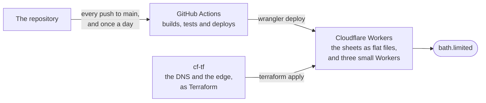

<p align="center">
  <a href="https://bath.limited">
    <picture>
      <source media="(prefers-color-scheme: dark)" srcset="bath-limited-on-ink.svg">
      
    </picture>
  </a>
</p>

<h1 align="center">Built to be inherited.</h1>

We look after the web applications, cloud platforms and devices that organisations run on, and when we’re done we hand all of it over, written down, so whoever comes next can carry on without us.

We come to you in Bath, Bristol and Cardiff, and work over a shared screen for anyone in the UK.

## Do good work for good people.

Before we recommend anything, we’ll find out what you need and, if you’re happy for us to, spend time with the people who use the kit every day, because they know what gets in their way. We’ve no favourite platform and no answer decided in advance. If what you’ve got already does the job, we’ll say so and leave it alone.

## Three things we do.

| [Websites & web apps](https://bath.limited/websites/) | [Cloud & Microsoft 365](https://bath.limited/cloud/) | [Device management](https://bath.limited/devices/) |
| :-- | :-- | :-- |
| Website design & build<br>Accessibility to WCAG 2.2 AA<br>Web applications, data & AI<br>Bilingual Welsh & English sites | Microsoft 365, Azure & Google Workspace<br>Identity & sign-in: Entra ID, Google, Okta & single sign-on<br>Migrations, backup & business continuity<br>Teams Phone & cloud calling | Mobile device management: Jamf Pro & Intune<br>Zero-touch enrolment & rollout<br>Platform & directory migration<br>Security baselines & Cyber Essentials |

When we migrate an organisation, staff go home on a Friday and come back on Monday to find their email, files and phone numbers exactly where they left them.

## What we hand over.

Nothing depends on one person remembering how it works, or on us being around to keep it running, and nobody gets locked into a platform that costs a fortune to leave. At the end of a job you get everything: the code and the rights to it, the accounts, the passwords and keys, and notes on why we did things the way we did. If a job can’t be done like that, we’ll tell you before we start.

> [!NOTE]
> Client work here is private to the client it was built for, so there’s no portfolio to browse. The thing of ours to look at is [bath.limited](https://bath.limited) itself, and [its colophon](https://bath.limited/colophon/) says how it’s made.

## Where our own site lives.



A client’s site is set out the same way, in a repository with a deploy of its own, and the lot goes to them at the end of the job.

<details>
<summary><b>For machines.</b> The site is written for them too.</summary>

| What | Where |
| :-- | :-- |
| A summary for assistants | [llms.txt](https://bath.limited/llms.txt) |
| Every sheet as Markdown | [index.md](https://bath.limited/index.md), and the rest beside their pages |
| The journal’s feeds | [RSS](https://bath.limited/rss.xml) · [JSON](https://bath.limited/feed.json) |
| The print edition, four pages of A4 | [edition.pdf](https://bath.limited/edition.pdf) |
| Our card | [bath-limited.vcf](https://bath.limited/bath-limited.vcf) |
| Our OpenPGP key | by [Web Key Directory](https://bath.limited/.well-known/openpgpkey/hu/im4cc8qhazwkfsi65a8us1bc5gzk1o4p), and as an OPENPGPKEY record in DNS |
| How to tell us about a security problem | [security.txt](https://bath.limited/.well-known/security.txt), as RFC 9116 sets it out |
| Who made it | [humans.txt](https://bath.limited/humans.txt) |

The front page comes to a terminal as a terminal sets text, and any page comes as Markdown when it’s asked for that way:

```sh
curl bath.limited
curl -H 'Accept: text/markdown' https://bath.limited/devices/
```

</details>

## Tell us a little about it.

There’s no need for a brief; a line or two is plenty to start with. Use [the form](https://bath.limited/#contact), or email, ring or WhatsApp us if you’d rather, and we’ll usually reply within a working day.

[bath.limited](https://bath.limited) · [Cymraeg](https://bath.limited/cy/) · hello [at] bath.limited · [01225 923923](tel:+441225923923) · [WhatsApp](https://wa.me/441225923923) · [Bluesky](https://bsky.app/profile/bath.limited)

> [!IMPORTANT]
> Found a security problem in something of ours? [SECURITY.md](https://github.com/BathLimited/.github/blob/main/SECURITY.md) says how to tell us, and how to encrypt it to us.

<sub>Bath Limited is registered in England & Wales, No. 14236546, at 214 High Street, Batheaston, Bath BA1 7QZ,[^1] and with the Information Commissioner’s Office as ZB514571. Our PGP key is <code>D869 A7C6 C803 A4AC 6219 EF0F A0E0 A15A 3816 6B6D</code>. Nothing of ours watches you on the site: no analytics, no third-party requests, and one cookie holding the language you last read it in.[^2]</sub>

[^1]: [On the map](registered-office.geojson), and in DNS: `dig LOC bath.limited`.
[^2]: Cloudflare, which serves the site, keeps the ordinary record of each request, as any server does. [The privacy statement](https://bath.limited/privacy/) says what that amounts to.
